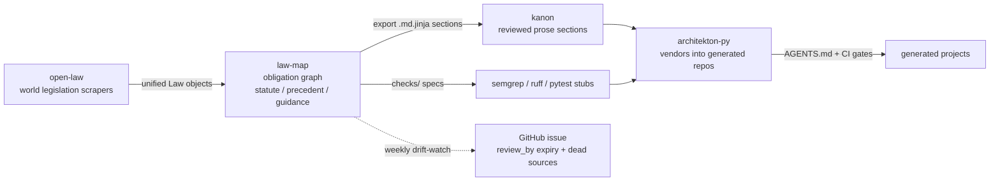

# law-map

Machine-readable **obligation graph** of a legal-compliance ecosystem: law,
organized as technical obligations mapped to jurisdiction groundings.

Instead of a flat "regulations" table, law-map stores *deontic rules you can
implement* (prohibitions, obligations, permissions) with the legal sources
that ground them — statutes, regulations, precedent, and guidance alike.
The unifying idea is **functional equivalence**: when a Japanese statute, an
EU regulation and a US FTC enforcement action all require the same technical
behavior, they are one obligation node with multiple groundings.

## Ecosystem



- [open-law](https://github.com/politeuma/open-law) — scrapes
  world legislation into unified Law objects (exists; untouched here).
- **law-map (this repo)** — organizes law as technical obligations, mapped
  to jurisdiction groundings covering civil law (statutes) and common law
  (precedent/guidance) via functional equivalence.
- [kanon](https://github.com/politeuma/kanon) —
  reviewed human/AI-facing prose sections consumed by templates.
- [architekton-py](https://github.com/politeuma/architekton-py) —
  vendors everything into generated AGENTS.md/CI.

## Layout

```
schemas/obligation.schema.yml   field reference (types, constraints, enums)
obligations/<domain>/<slug>.yml one obligation per file (reviewed by humans)
checks/<domain>/<slug>.yml      machine-check specs, optional per obligation
src/law_map/                    loader, validator, checker, exporter, CLI
tests/                          pytest suite (offline)
docs/why-law-map.md             design note: functional equivalence
.github/workflows/              ci.yml, drift-watch.yml (weekly review scan)
```

## Quickstart

```bash
uv sync
uv run law-map validate            # load corpus, report every error/warning
uv run law-map validate --kanon kanon/   # also cross-check related_sections against a kanon checkout
uv run law-map list                # all obligation ids
uv run law-map show privacy/no-cleartext-pii-logging
uv run law-map check               # groundings due for review (default 30 days)
uv run law-map check --sources --days 30   # also HEAD-check source URLs
uv run law-map export --out out/   # kanon-style .md.jinja section skeletons
uv run pytest -q
uv run ruff check .
uv run mypy src/law_map
```

Or with [just](https://github.com/casey/just): `just check` runs validate +
pytest + ruff + mypy.

## Validation contract

`law-map validate` exits non-zero if the corpus violates any rule in
`schemas/obligation.schema.yml` (implemented in `src/law_map/model.py`):
required fields, enums, id pattern (`obligation.<domain>.<slug>`) and
uniqueness, grounding shape (jurisdiction, source_type, status, authority,
citation, ISO `review_by`, non-empty http(s) `sources`, optional `open_law`
`{source, id}` ref into open-law for amendment detection), and cross-references
(`requires`/`conflicts` ids, `enforcement.check_refs` files). Files whose
basename starts with `_` are excluded from the corpus (see
`obligations/_example.yml`). `related_sections` ids (`<tier>-<slug>`) are
resolved only with `--kanon <checkout>`: then each must resolve to
`sections/<tier>/<slug>.md.jinja` per the `<tier>-<slug>` naming rule, and an id
not present becomes an error, while kanon sections that no obligation's
`related_sections` references are reported as warnings (reverse coverage),
never errors. Without `--kanon` the ids are unchecked.

## Review freshness

Every grounding carries a `review_by` date — the freshness contract. A grounding
may also carry an optional `open_law` ref (`{source: <open-law source_id>, id:
<source-native law id>}`, e.g. `{source: jp, id: 415AC0000000057}` for APPI or
`{source: eu, id: 32016R0679}` for GDPR) that `law-map check --sources` resolves
through `open_adapter(source).fetch(id)`: an upstream `modified` newer than the
grounding's `effective` date is reported as `[open-law amended]` with a sha256 of
the fetched text. Refs skip silently when the `open-law` package is not installed
and report `[open-law unavailable]` when the source serves no machine full text.
The weekly `drift-watch` workflow runs `law-map check --sources --days 30` and
opens one GitHub issue (`law-drift` label) listing groundings due or expired,
source URLs that now 404 or redirect, plus amended or unreachable open-law refs;
when a run is clean it closes any open `law-drift` issue with a "drift resolved"
comment. `law-map check` exits 1 when any grounding is expired, so the workflow
can gate on it.

## Pipeline

```bash
just pipeline   # upstream→downstream: validate the corpus, then review-freshness check
```

`just pipeline` runs `uv run law-map validate && uv run law-map check --days 30`.
`law-map check --days 30` prints one `[EXPIRED] <id> (<jurisdiction>): <citation>`
or `[due by <review_by>] ...` line per grounding due within the horizon, and exits 1
when any grounding is expired. With `--sources` it additionally HEAD-checks grounding
source URLs (`[source <not-found|redirect|unreachable>] <url>` plus a
`source probes: <N> total, <M> flagged` line) and resolves every grounding `open_law`
ref (`[open-law <amended|unavailable|unreachable>] <id> <source>:<law_id>`,
`[skipped] <id>: ...` when the `open-law` package is not installed, plus an
`open-law probes: <N> total, <M> flagged, skipped: <K>` line). The run ends with
`review check: <D> due within 30 day(s), 0 expired` on success.

## Contributing

Obligation changes start as a [Legal RFC
issue](https://github.com/politeuma/law-map/issues/new?template=legal_rfc.yml)
using the existing template; see [CONTRIBUTING.md](CONTRIBUTING.md) for
grounding requirements and the validation commands.

## License

Apache-2.0. See [LICENSE](LICENSE).

**Not legal advice.** law-map records what instruments say and where they are
pinned; it does not interpret them for a specific situation. See
`docs/why-law-map.md`.